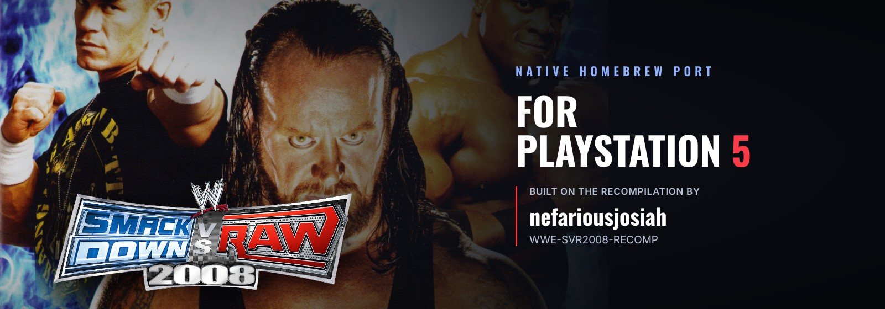
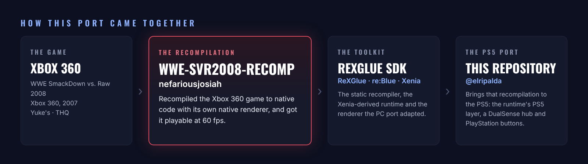

<p align="center">
  
</p>

<p align="center">
  <a href="../../releases/latest"></a>
  
  <a href="https://github.com/nefariousjosiah/WWE-SVR2008-RECOMP"></a>
  <a href="https://discord.gg/GgDE5Vynyu"></a>
</p>

<p align="center">
  <a href="https://recompstore.com/game/PPSA92008"></a>
</p>

<p align="center">
  <b>WWE SmackDown vs. Raw 2008</b> running natively on a jailbroken PS5,<br>
  a port of <a href="https://github.com/nefariousjosiah/WWE-SVR2008-RECOMP"><b>nefariousjosiah's WWE-SVR2008-RECOMP</b></a>.
</p>

<p align="center">
  <a href="../../releases/latest"><b>Download</b></a> ·
  <a href="#install">Install</a> ·
  <a href="#controls">Controls</a> ·
  <a href="#building-from-source">Build from source</a> ·
  <a href="#credits">Credits</a>
</p>

---

<p align="center">
  
</p>

> [!NOTE]
> **This is a port of someone else's project.** The recompilation of SmackDown vs. Raw 2008, its native renderer and getting it playable at 60 fps are the work of **[nefariousjosiah](https://github.com/nefariousjosiah)** in [WWE-SVR2008-RECOMP](https://github.com/nefariousjosiah/WWE-SVR2008-RECOMP), whose code and history are the base of this repository. This repository adds what the PS5 needs to run it (mostly in [`ps5/`](ps5)): the PS5 build, a hub made for the DualSense, and PlayStation button pictures. If you enjoy it, go give the original project a ⭐.

## What it is

A PS5 homebrew app (title ID `PPSA92008`) that runs SmackDown vs. Raw 2008 as native code. It isn't an emulator: the Xbox 360 game is statically recompiled with the [ReXGlue SDK](https://github.com/rexglue/rexglue-sdk), as WWE-SVR2008-RECOMP does on PC, and draws through that project's native renderer on Vulkan (Mesa RADV).

It opens on its own **hub**, where you change settings and manage saves with the controller, then start the game.

> [!IMPORTANT]
> **No game files are included.** You need your **own Xbox 360 copy** of SmackDown vs. Raw 2008 as a disc image (`.iso`).

## Features

- **60 fps**, using the game's own 60 fps mode, so matches and entrances play at the right speed.
- **Up to 4K**: 720p (the console's), 1440p or 4K, with anisotropic filtering.
- **PlayStation buttons**: every Xbox button picture in the menus, help bars and match prompts is swapped for a PlayStation one, in all four of the disc's languages. The controller on the superstar select screens is a DualSense.
- **Unlock Everything**: one setting opens every superstar (legends included), arena and WWE Shop item. Your save isn't changed, so turning it off puts you back where you were.
- **Picture settings**: Bloom (Off by default, which fixes the washed-out entrance shots), the Xbox 360's display gamma, and its original edge blur if you want it back.
- **The hub**: Home, Settings, Saves and About pages, with menu music (a random song each time, **R3** for the next) and an FPS counter you can turn on or off.
- **Save backups**: back up and restore your saves from the hub.

## Install

You need a jailbroken PS5 that runs homebrew apps from `/data/homebrew/`, with a homebrew launcher that lists them.

**With [RecompStore](https://recompstore.com):** install SmackDown vs. Raw 2008 and give it your disc image. It puts the app in `/data/homebrew/PPSA92008/` and the game in its `Assets/` folder. Start the app and press **START GAME**.

**By hand** (an FTP client):

1. Download `PPSA92008.zip` from [Releases](../../releases) and unzip it on your PC.
2. Over FTP, copy the `PPSA92008` folder into `/data/homebrew/`.
3. Either copy your `.iso` into `/data/homebrew/PPSA92008/`, or extract it (with a tool such as extract-xiso, leaving out `$SystemUpdate`) and copy the files into `/data/homebrew/PPSA92008/Assets/`, so you have `Assets/default.xex`, `Assets/pac/` and the rest of the disc.
4. Start **SmackDown vs. Raw 2008** from your homebrew launcher and press **START GAME**.

The download's `HOW TO INSTALL.txt` has the same steps and the hub's controls.

## Controls

| DualSense | Xbox 360 |
|---|---|
| Cross / Circle / Square / Triangle | A / B / X / Y |
| L1 / R1 | LB / RB |
| L2 / R2 | LT / RT |
| L3 / R3 | stick clicks |
| Options | Start |
| Touchpad click | Back |

In the hub: **L1 / R1** change pages, **Cross** selects, **Circle** goes back, **Options** starts the game, **R3** changes the song.

## Menu music

Put your own songs (MP3, WAV, FLAC or OGG) in `/data/homebrew/PPSA92008/hub/music/`.

## Updating

Copy a newer `PPSA92008` folder over the old one, or update from RecompStore. The game (`Assets`), your saves (`UserData`), backups and settings are kept.

## Known issues

- Online play (Xbox LIVE) doesn't work, and its menu entries still say Xbox LIVE.
- Some text still mentions the Xbox 360 console (the save messages), and the tutorial videos show an Xbox 360 controller.

## Reporting a problem

Report bugs on the **[RIPALDA Discord](https://discord.gg/GgDE5Vynyu)**. Send the newest file from `/data/homebrew/PPSA92008/logs/` (and `UserData/crashes/` if there is one), with what you were doing.

> [!TIP]
> ### 💙 Enjoying the port?
> If you've gotten some enjoyment out of this project, donations and love are always appreciated. Every bit helps keep these ports growing. Thank you!
>
> [](https://ko-fi.com/ripalda)

## Building from source

The repository's root is WWE-SVR2008-RECOMP as nefariousjosiah made it (its Windows and Linux build; see [`README-SVR2008-RECOMP.md`](README-SVR2008-RECOMP.md)). The PS5 port is in [`ps5/`](ps5), with its additions to the renderer in `src/native/` (`svr_pad_art.cpp`, `svr_unlock_all.cpp`, `svr_display_ramp.cpp`). The runtime's PS5 layer is the `rexglue-ps5-svr2008` branch of the SvR 2011 PS5 port, and the PS5 toolchain file comes from that port too (`port/cmake/ps5-toolchain.cmake`).

1. Put your own `default.xex` in `assets/` and run `rexglue codegen svr2008_manifest.toml`.
2. Configure and build:
   ```sh
   cmake -S ps5 -B ps5/out/ps5 -G Ninja -DCMAKE_BUILD_TYPE=Release \
     -DCMAKE_TOOLCHAIN_FILE=<svr2011-ps5>/port/cmake/ps5-toolchain.cmake \
     -DPS5_PAYLOAD_SDK=<ps5-payload-sdk> -DREXSDK_DIR=<rexglue-ps5-svr2008 checkout>
   ninja -C ps5/out/ps5 svr2008
   ```
3. Make the PlayStation button pack from your own game files. It needs Python with Pillow, NumPy, SciPy and pycairo, the Anton and Oswald fonts installed, and a front picture of the DualSense with a transparent background:
   ```sh
   python3 ps5/tools/ps_buttons/build.py <extracted disc> ps5/art/local/ps_buttons <dualsense.png>
   ```
4. Link and package it as an app folder with `ps5/tools/ps5_package.sh ps5/out/ps5 <ps5-plume-triangle checkout> PPSA92008`. The hub's pictures go in `ps5/art/local/hub/` (as in the release's `hub/` folder) and aren't in the repository.

## Credits

- **[nefariousjosiah](https://github.com/nefariousjosiah)**: [WWE-SVR2008-RECOMP](https://github.com/nefariousjosiah/WWE-SVR2008-RECOMP), the recompilation and native renderer this port is built on.
- **[ReXGlue](https://github.com/rexglue/rexglue-sdk)**: the static recompiler and runtime.
- **[re:Blue](https://github.com/zolaware/reblue)**: the renderer WWE-SVR2008-RECOMP's was adapted from.
- **[Xenia](https://xenia.jp)**: the Xbox 360 emulator the runtime's code comes from.
- **PS5 tooling**: the PS5 Payload SDK; Nazky's ps5-plume-triangle / UnleashedRecomp-Prospero and mihawk-99's RADV link recipe; Mesa RADV.
- **Libraries**: Dear ImGui, stb_image, stb_vorbis, dr_mp3, dr_flac; Oswald, Inter and Anton fonts (SIL Open Font License).
- **[@elripalda](https://github.com/elripalda)**: the PS5 port, its hub and the PlayStation buttons. Developed with [Claude Code](https://claude.com/claude-code).

## Disclaimer

An unofficial fan project, not affiliated with or endorsed by WWE, THQ, Yuke's, Microsoft or Sony. WWE SmackDown vs. Raw 2008 and all related names and art belong to their owners. This repository and its releases contain no game files: you need your own copy of the game. WWE-SVR2008-RECOMP's code is under its [GPL-3.0 licence](LICENSE); code from other projects keeps its own licence (see [THIRD_PARTY.md](THIRD_PARTY.md)).
